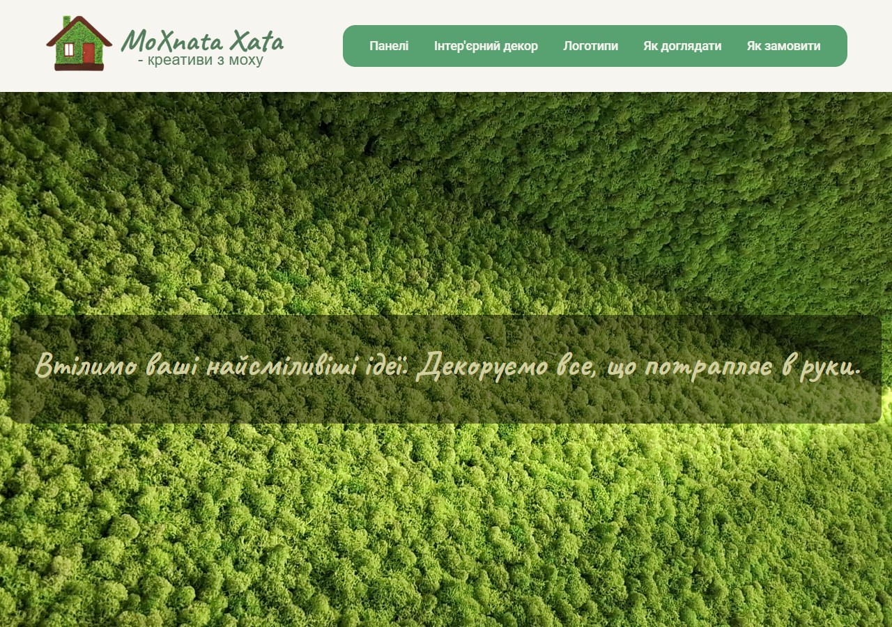

# Faskat.github.io

Статический сайт «Мохната Хата» об эко-дизайне с мхом, на HTML/CSS/JavaScript.
Исходная страница находится в `index.html`, фотографии — в `Images/`.
Статус: опубликованные исходники статического сайта; актуальность содержания
и работа заявок требуют отдельной ручной проверки.

Платформа: Windows, Linux или macOS. Для локального просмотра нужен Python 3.12:

```sh
python -m http.server 8123 --bind 127.0.0.1
```

Откройте `http://127.0.0.1:8123`. Сборка и зависимости не нужны.
`python scripts/check_site.py` проверяет HTML и существование локальных
изображений и ссылок. CI выполняет эту проверку для push и PR, без отправки форм.
Страница хранится в UTF-16 с BOM; проверка учитывает эту кодировку.
Локальный предварительный просмотр в Edge, 1280×900 (13 октября 2026):


